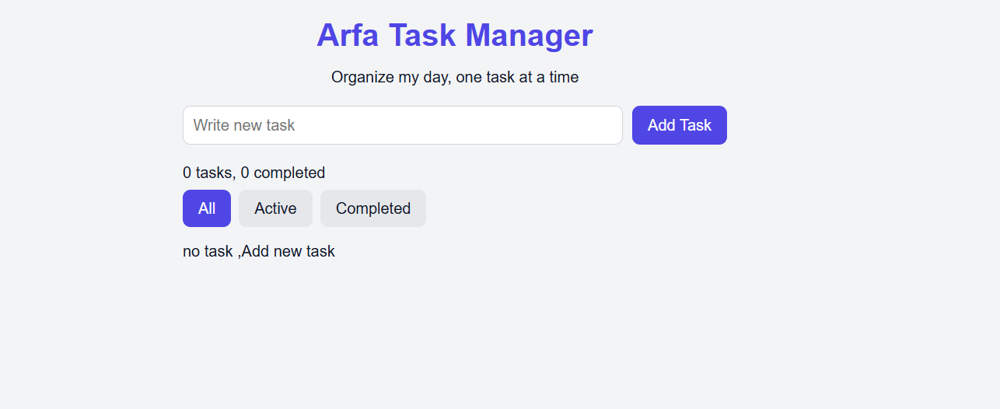
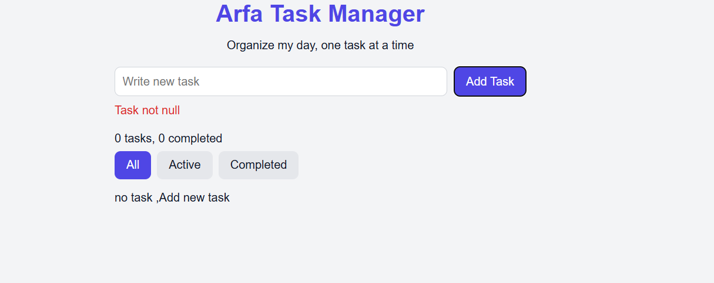
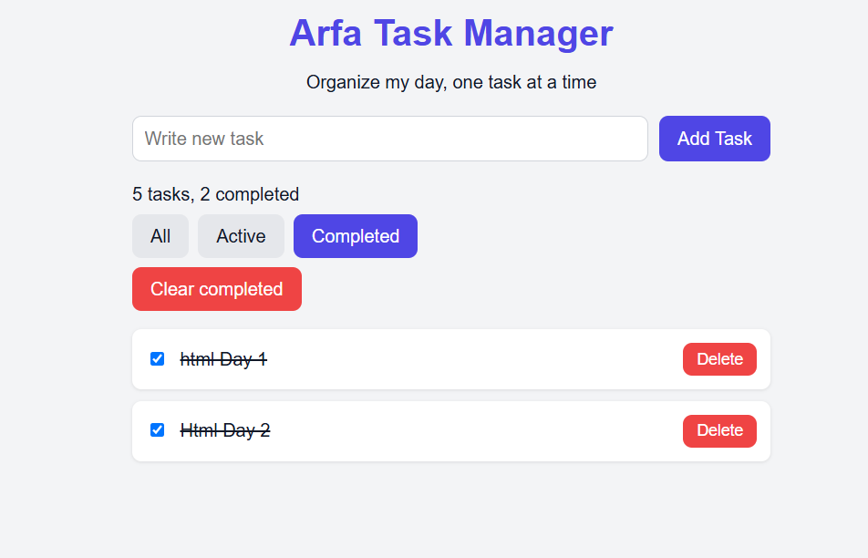

# React Task Manager

A task manager built with React and Vite as part of the **AUREX Full-Stack Internship (Month 2, Week 1)**.

## Live Demo

https://aurex-fullstack-internship-arfa.vercel.app/

## Features

- Add tasks with input validation (empty tasks are not allowed)
- Mark tasks as completed
- Delete tasks
- Filter tasks: All / Active / Completed
- Task count and "Clear completed" button
- Tasks are saved with localStorage, so they stay after a page refresh
- Responsive design for mobile and desktop

## Technologies Used

- React.js
- Vite
- JavaScript (ES6)
- CSS3
- localStorage
- Git & GitHub
- Vercel (deployment)

## Component Structure

```
App
 ├── Header
 ├── TaskForm
 ├── TaskFilter
 └── TaskList
      └── TaskItem
```

- **App**: stores the main state (`tasks` and `filter`) and all the main functions (add, toggle, delete, clear completed)
- **Header**: shows the app title
- **TaskForm**: controlled input with validation
- **TaskFilter**: filter buttons, task count and the clear completed button
- **TaskList**: shows the list of tasks, or an empty-state message when there are none
- **TaskItem**: shows one task with a checkbox and a delete button

## How It Works

- **State:** `tasks` and `filter` are stored in `App` using `useState`, because more than one component needs this data.
- **Props:** `App` passes data and functions down to child components as props (for example `tasks`, `onToggle`, `onDelete`, `onAddTask`).
- **Events:** when the user clicks or types, child components call the functions received through props. `App` then updates the state and React re-renders the UI.
- **Forms:** `TaskForm` uses a controlled input. Its value comes from state and is updated with `onChange`. On submit, an empty input shows a validation error.
- **Persistence:** `useEffect` saves the tasks to localStorage whenever they change, and the saved tasks are loaded when the app starts.

## Screenshots






## How to Run Locally

```bash
git clone https://github.com/YOUR-USERNAME/aurex-fullstack-internship-arfa.git
cd aurex-fullstack-internship-arfa/week-1-react-task-manager
npm install
npm run dev
```

## What I Learned

- How to set up a React project with Vite and how the project structure works (`main.jsx`, `App.jsx`, `src`, `package.json`).
- How to write JSX and build reusable components.
- How to pass data and functions between components using props.
- How `useState` works and why state is kept in a parent component when several components need it.
- How to handle events (`onClick`, `onChange`, `onSubmit`) and build a controlled form with validation.
- How to render lists with `map()` and why each item needs a `key`.
- How to use `useEffect` with localStorage to keep data after a refresh.
- How to use Git/GitHub with meaningful commits and deploy a React app on Vercel.

## Blockers / Issues

- Node.js was not installed at first, so `node` and `npm` commands were not recognized. I installed Node.js (LTS) and restarted VS Code.
- PowerShell blocked npm scripts. I fixed it by changing the execution policy for the current user.
- At first I ran Git commands from the wrong folder. I learned to check which folder the terminal is in before running commands.
- Vercel could not find the project at first because it is inside a sub-folder. I fixed it by setting the Root Directory to `week-1-react-task-manager`.
